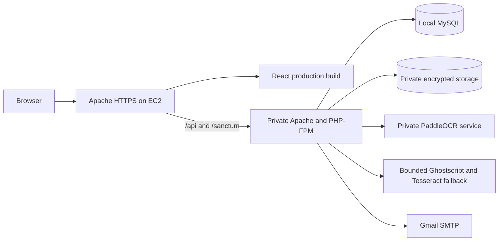

# AcadeX complete client and AI handoff

Prepared: **October 19, 2026, Asia/Manila**.

Audience: the client, the client's incoming developer, and the client's coding AI.

Purpose: transfer the project knowledge needed to maintain, troubleshoot, update, and deploy AcadeX without depending on the previous developer's laptop or having that developer perform each future release.

Publication note: this document's earlier dirty-worktree counts describe the preparation checkpoint. The client handoff publication groups the reviewed source fixes and documentation in Git. Read [the publication record](docs/handoff/PUBLICATION_2026-10-19.md) and section 25, then inspect the received commit and current worktree rather than assuming those original uncommitted counts still apply.

This document consolidates the repository, deployment history, known server layout, operating procedures, ownership requirements, and remaining work. Source files and fresh runtime observations take precedence over historical descriptions. No document can guarantee that every future change will work; use the verification and rollback procedures here for each release.

Quick navigation:

- [Start here and current evidence](#1-start-here)
- [Architecture and repository map](#3-system-and-repository-map)
- [AWS and host baseline](#4-last-verified-aws-and-host-baseline)
- [Release paths and persistent data](#5-release-paths-and-persistent-data)
- [Client workstation setup](#11-setting-up-the-clients-own-workstation)
- [Publishing the actual source fixes](#12-move-the-actual-fixes-into-the-shared-git-repository)
- [Future release and rollback procedure](#13-future-deployment-procedure-for-the-clients-maintainer)
- [Tests and their boundaries](#14-tests-and-evidence-boundaries)
- [Troubleshooting and remaining work](#16-known-remaining-work-and-troubleshooting)
- [Complete ownership checklist](#18-complete-client-independence-checklist)
- [Prompt for the client's AI](#19-prompt-the-client-can-give-its-ai)
- [Configuration reference](#22-configuration-reference-what-the-next-operator-must-set-or-preserve)
- [Complete takeover phases](#23-step-by-step-complete-takeover-sequence)
- [Incoming AI's result-report template](#24-result-reporting-template-for-the-incoming-ai)
- [Git publication and remaining private handover](#25-git-publication-and-the-remaining-private-handover)

## 1. Start here

### 1.1 Intended ownership and operating model

The client owns AWS, billing, the domain and DNS, the GitHub repository, application data, the production email service, and future maintenance. The client or the client's developer performs future deployments. The previous developer may hand over documentation and source once, then should cease being a required part of the release process.

The existing production services were installed on EC2. The Windows laptop was a development and administration workstation. Production was not served by a laptop process, a development server, or a laptop SSH tunnel.

The handoff does not automatically install a GitHub deployment pipeline. The client's team may continue manual releases from its own workstation or design its own reviewed automation later. Either approach must use client-controlled accounts and preserve persistent production data.

### 1.2 Reading order for an incoming AI

1. Read this file and [AGENTS.md](AGENTS.md).
2. Inspect Git status, current files, remotes, lockfiles, and any newer instructions. Do not assume this document means the worktree is clean.
3. Read the dated handoff evidence under [docs/handoff](docs/handoff).
4. Read [ACADEX_PRODUCTION_DEPLOYMENT_REPORT.md](ACADEX_PRODUCTION_DEPLOYMENT_REPORT.md), especially the final October 14 handoff at the top. Earlier sections in that report are explicitly preserved historical checkpoints.
5. Read [docs/ACADEX_ACCESS_POLICY.md](docs/ACADEX_ACCESS_POLICY.md) before changing authorization or document access.
6. Read the relevant implementation before changing it. Repository files referenced below are the actual behavior owners.
7. Establish the client's current goal and authorized access. Reading a context file is not an instruction to run every maintenance command in it.

### 1.3 Current versus historical evidence

| Item | Evidence date | State and meaning |
| --- | --- | --- |
| Working EC2 deployment, owner phone login, owner inbox receipt | October 14 | Verified then; ready for controlled owner testing, not exhaustive acceptance of every workflow |
| Local repository inspection | October 19 | Branch `main`; HEAD `4560e3f32e6cd8b6f63e0c2a4373b8b94f241546`; 92 tracked changes and 50 untracked entries before adding these handoff files |
| Git remote | October 19 | `origin` points to `https://github.com/tfsephyy/AcadeX.git` |
| Root GitHub Actions workflows | October 19 | No `.github/workflows` deployment workflow was present |
| Root and WWW DNS from this workstation | October 19 | Both resolved to `54.153.196.115` |
| Public HTTPS checks | October 19 | Requests to root, login, WWW, CSRF-cookie, and anonymous user routes could not complete from this workstation; a focused follow-up reported a connection timeout |
| SSH to the known instance address | October 19 | Connection to port 22 timed out from this workstation; no server configuration was changed |
| Current instance state, service state, current credits, current database contents | October 19 | NOT VERIFIED because server access could not be established during this documentation task |

The October 19 timeouts require investigation by the client with current AWS access. They do not identify the cause. Check the existing instance's state and status checks, network rules, the connecting network, address association, and account status before deciding on a repair. Do not create a replacement instance or overwrite the working installation merely because this workstation cannot connect.

### 1.4 Essential facts to retain

- The directory name `/srv/acadex-staging` is historical. It contained the installation serving the public production domain; do not infer a separate disposable staging environment from its name.
- The deployed state included uncommitted source fixes. The Git commit alone does not reconstruct that deployed state.
- Preserve the original production `APP_KEY`. Existing PDFs and resources depend on it for decryption.
- Production `.env`, private storage, and database records are not contained in a normal Git clone.
- Application Admin access, GitHub access, AWS-console access, and SSH access are four distinct things.
- The client must own its own working access before the previous maintainer's access is removed.
- The model cache and Python environment are operating dependencies. A Windows virtual environment cannot be copied to Ubuntu.
- Do not use `composer setup` on the existing production installation: this repository's setup script calls `php artisan key:generate`.

## 2. Scope of this handoff

Included: architecture, public routing, server identifiers and paths, source ownership, deployment changes, account-role history without passwords, configuration names, operating commands, update procedures, testing boundaries, recovery guidance, known failures, remaining work, and the steps for complete client independence.

Excluded from Git and this document: actual `.env` values, production `APP_KEY`, SMTP credentials, database passwords, SSH private keys, application passwords, student documents, database dumps, and private model/configuration backups. Their locations and required owner actions are documented instead. Transfer private recovery material only through a client-controlled encrypted channel or vault.

Do not copy terminal history, `.local`, the previous developer's whole home directory, or installed dependency directories into Git to simulate a handoff. Reproduce the environment from instructions, lockfiles, and client-owned access.

## 3. System and repository map



| Location | Responsibility |
| --- | --- |
| `EduArchive-Frontend-React/` | React 19 / Vite 7 application, routing, role dashboards, account UI, chatbot UI |
| `EduArchive-Frontend-React/src/api/` | API clients and production API-base resolution |
| `EduArchive-Frontend-React/src/context/AuthContext.jsx` | Browser authentication state and user loading |
| `EduArchive-Frontend-React/src/components/ProtectedRoute.jsx` | Protected frontend navigation; server authorization remains authoritative |
| `EduArchive-Backend-Laravel/` | Laravel 12 API and application services |
| `EduArchive-Backend-Laravel/routes/api.php` | `/api/v1` routes, middleware, role groups, upload throttles |
| `EduArchive-Backend-Laravel/app/Http/Controllers/Api/V1/` | Authentication, capstones, users, dashboards, notifications, chatbot API |
| `EduArchive-Backend-Laravel/app/Services/` | Mail, authorization queries, encryption, staged uploads, OCR connectors and extraction |
| `EduArchive-Backend-Laravel/app/Policies/CapstonePolicy.php` | Record and document action authorization |
| `EduArchive-Backend-Laravel/app/Services/CapstoneAccess.php` | Role-aware query and record visibility rules |
| `EduArchive-Backend-Laravel/app/Models/User.php` | Account roles, verification/approval state, authorization-version behavior |
| `EduArchive-Backend-Laravel/database/migrations/` | Schema evolution; 29 migrations were applied on October 14 |
| `EduArchive-Backend-Laravel/app/Console/Commands/BootstrapAdmin.php` | Explicit private administrator provisioning |
| `EduArchive-Backend-Laravel/ocr-service/` | FastAPI / CPU PaddleOCR, request validation, recognition and PDF processing |
| `deploy/` | Service examples with placeholders; not proof of the currently installed units |
| `docs/ACADEX_ACCESS_POLICY.md` | Approved role/document access contract and university-acceptance boundary |
| `docs/ACADEX_OCR_OPERATIONS.md` | Earlier OCR preparation; some environment statements were superseded by deployment observations |
| `start-local.ps1`, `stop-local.ps1` | Windows development process management; not production services |
| `SETUP.md` | Original workstation setup history and local commands; not a current production runbook |
| `.local/` | Ignored workstation tooling, logs, evidence, temporary test material, and source backups; not part of a normal clone |

The frontend's `vercel.json` is a repository artifact from an earlier hosting arrangement. It does not describe the active EC2 release process. WWW previously pointed to an obsolete Vercel deployment and was corrected.

## 4. Last verified AWS and host baseline

These are October 14 facts unless a newer observation is explicitly stated. Confirm them in the client's account before changing resources.

| Item | Last verified value |
| --- | --- |
| Domain | `veload.site` |
| Canonical login | `https://veload.site/login` |
| WWW behavior | Permanent redirect to canonical root, preserving path and query |
| Region | `ap-southeast-2`, Sydney |
| EC2 instance | `i-04dcf0ae3c97230ad` |
| Instance type | `t3.small`, x86_64 |
| Public Elastic IP | `54.153.196.115` |
| Elastic IP allocation | `eipalloc-0508f381bfd853ba0` |
| Elastic IP association | `eipassoc-080d66c409ae2643a` |
| Security group | `sg-0328aac4704a227f6`, `acadex-sg` |
| Root EBS volume | `vol-070a597b5dfc8237c`, 30 GiB encrypted, delete-on-termination enabled |
| Operating system | Ubuntu 24.04.5 LTS |
| PHP / Laravel observed on EC2 | PHP 8.3.6 / Laravel 12.69.3 |
| Login identity used by the previous operator | `ubuntu`; the incoming maintainer needs independently authorized access |
| Database | MySQL on the same instance, private loopback listener |
| Available memory baseline | Approximately 1,905 MiB RAM and 2,047 MiB swap; this is a small combined application/OCR host |
| Instance CPU credit mode | `standard` when inspected |
| Instance metadata | IMDSv2 required when inspected |
| IAM role on instance | None when inspected |

Network baseline: public TCP 80/443; SSH TCP 22 restricted to one owner's `/32`; outbound allowed; no public MySQL, backend, or OCR ingress rule. The October 19 connecting network may not match the allowed SSH source. A timeout alone does not prove which rule or host state is responsible.

Private listeners observed: Apache `127.0.0.1:8080`, `127.0.0.1:8081`, `127.0.0.1:8443`; OCR `127.0.0.1:8001`; MySQL `127.0.0.1:3306` and `33060`.

UFW was inactive when checked; AWS security-group restrictions were inspected separately. Do not expose private services to make debugging easier.

### 4.1 Account plan and cost ownership

On October 14 the console showed Free Plan, $100 credits, and April 14, 2027 as the displayed plan-end date. These are historical readings, not today's balance. The inspected Cost Explorer range was April through September 2026, so its zero total did not establish zero October usage.

The prior deployment continuation did not add or resize AWS hosting resources, upgrade the billing plan, or add a paid hosting service. Existing EC2/EBS/public-address usage can consume credits. The client must check its current balance, plan conditions, and renewal/closure timing. Do not promise indefinitely free hosting or enable a plan upgrade as an incidental deployment step.

## 5. Release paths and persistent data

| Purpose | Last verified path |
| --- | --- |
| Release root | `/srv/acadex-staging/releases/acadex-remediation-d61a0aa271f7a1e4` |
| Backend | `<release-root>/EduArchive-Backend-Laravel` |
| Frontend served build | `<release-root>/EduArchive-Frontend-React/dist` |
| OCR source | `<release-root>/EduArchive-Backend-Laravel/ocr-service` |
| Private Laravel environment | `/srv/acadex-staging/shared/config/laravel.env` |
| Persistent application storage | `/srv/acadex-staging/shared/storage` |
| PHP private temporary directory | `/srv/acadex-staging/shared/private-tmp` |
| Shared OCR virtualenv directory seen at discovery | `/srv/acadex-staging/shared/ocr-venv`; confirm the running unit's executable before use |
| Private server backup root | `/var/backups/acadex` |
| Original working Paddle model cache | `/home/ubuntu/.paddleocr/whl` |
| Server overlay record | `<release-root>/ACADEX_FINALIZATION_MANIFEST.json` |

The backend `.env` and `storage` were symlinks to shared persistent locations. They are not release-local disposable content. PHP's private temporary directory was owned by `www-data`, mode `0700`; private temporary files were verified `0600`. The shared Laravel environment was `0640`, owned by `ubuntu:www-data`.

Do not assume every path under `shared` is populated or currently used. An earlier shared OCR-model directory was empty; the actual original models were in the Ubuntu home cache. Some private copied model/cache directories and an inactive service user were retained after a rolled-back experiment. Inspect the actual running unit and interpreter before deciding which paths are active.

### 5.1 Source identity and manifest limitations

The initial release had a 263-file manifest. A strict verifier rejected a storage placeholder because its shared-storage symlink resolved outside the release root. A separate byte comparison matched all 263 files at that earlier checkpoint. These are different checks; the strict verifier was not declared to pass.

The subsequent deployed overlay was `acadex-finalization-20261014-aec14026f1`, with 21 deployed paths checked at the main overlay checkpoint. The native OCR helper was corrected again afterward and its server manifest entry updated. The served frontend JavaScript was `index-CRbaLIEW.js`; CSS was `index-ByTWH9YB.css`. The previous JavaScript bundle was retained for existing open tabs.

`ACADEX_RELEASE_MANIFEST.json` and `scripts/verify-release-manifest.py` describe the earlier candidate. Do not report them as passing unchanged for the final overlay. Reconstruct a new release identity from actual source and the live overlay manifest before the next deployment. Git HEAD remained the original commit while the worktree contained the fixes.

## 6. Public routing, DNS, and TLS

Apache served the compiled React application over HTTPS. `/api/` and `/sanctum/` were proxied to the private Laravel backend at `127.0.0.1:8081`. The backend virtual host served Laravel's `public/` directory through PHP-FPM.

Relevant configuration names from the installation include `acadex-public.conf`, `acadex-http.conf`, `acadex-private.conf`, `acadex-www.conf`, `000-default.conf`, and the loopback HTTPS preview configuration. Inspect `/etc/apache2/sites-enabled`, `/etc/apache2/sites-available`, `apache2ctl -S`, and `/etc/apache2/ports.conf` to establish current enabled files. Do not replace every Apache configuration with an example from this repository.

The host used separate root and WWW certificate lineages. Renewal was converted from manual DNS-01 to webroot HTTP-01 using `/var/www/letsencrypt`. Both renewal dry-runs passed, including an Apache reload deploy hook; `certbot.timer` was active and enabled. The original certificates then expired January 11, 2027 UTC. The incoming maintainer must inspect current certificates and timer state.

HTTP challenge routing must remain reachable for renewal. A separate WWW HTTPS virtual host handles the redirect before application login. Canonical frontend/API URLs must remain consistent so secure session cookies, CSRF, and CORS continue to work.

The owner's earlier phone login failed at WWW and succeeded at the canonical root. Old WWW DNS caching was an inference supported by the missing AWS login requests and corrected routing, not a captured phone DNS trace. Diagnose future failures from current DNS and network requests instead of assuming the same cause.

Sensitive-looking paths such as `/.env`, `/.git/config`, and `/storage/app/private/` returned the same React SPA HTML with HTTP 200 when probed; no environment contents, Git data, or directory listing were observed. Do not call those results HTTP 404 checks. SPA HTML status 200 alone does not prove a private document route is protected.

## 7. Authentication, roles, and mail

### 7.1 Request flow

Production uses same-origin requests with `VITE_API_BASE_URL=/api/v1`. The frontend initializes CSRF/session state, sends login requests with cookies, and loads the current account through `/api/v1/user`. Relevant public routes include `/api/v1/csrf-token`, `/api/v1/login`, `/api/v1/register`, `/api/v1/forgot-password`, `/api/v1/verify-reset-code`, and `/api/v1/reset-password`. Authenticated logout is `/api/v1/logout`.

The server enforces role, approval, verification, archived-account state, and authorization-version/session behavior. Frontend route guards are not the authorization boundary. Role or credential changes may invalidate earlier sessions; confirm behavior before calling a fresh login failure a wrong-password issue.

Effective configuration observed on October 14: production environment; debug disabled; canonical root application/frontend URLs; database sessions; secure, HttpOnly, host-only cookies; SameSite Lax; credentialed CORS restricted to the canonical origin; explicitly configured loopback trusted proxies.

### 7.2 Account history

The archive originally had one approved, verified Admin. At the owner's request, three accounts were added and that original Admin changed to Faculty. The four requested accounts covered Admin, Faculty, Student, and Visitor, were approved and verified, and intentionally shared the original account's password for controlled testing. Stored password equality was checked internally; no plaintext password was needed.

A fifth approved, verified Student appeared after that provisioning transaction and was left unchanged. Thus the final October 14 inventory was one Admin, one Faculty, two Students, and one Visitor. This is historical, not today's account list. The publication copy of the deployment report uses role/private-mailbox placeholders; obtain actual account identifiers and login credentials from the client's private handoff records. The shared test-password arrangement is not an instruction to reset accounts or retain shared passwords for wider use.

The provisioned Student used a clearly marked synthetic test profile, including test academic/identifier data. Do not treat that profile as verified real university information or replace real users' profiles from this historical example.

Do not rerun account creation, reset user passwords, replace registered emails, or run seeders as part of an ordinary code deployment. `acadex:bootstrap-admin` is the explicit private bootstrap command when the owner actually needs it.

### 7.3 Mail behavior

The serving application used its existing Gmail SMTP configuration, port 465, with `MAIL_SCHEME=smtps`. This Laravel mail configuration reads `MAIL_SCHEME`; adding only `MAIL_ENCRYPTION` does not configure the same transport.

Relevant names: `MAIL_MAILER`, `MAIL_HOST`, `MAIL_PORT`, `MAIL_SCHEME`, `MAIL_USERNAME`, `MAIL_PASSWORD`, `MAIL_FROM_ADDRESS`, and `MAIL_FROM_NAME`. Keep values private and preserve the authorized sender during normal deployment.

An isolated harmless SMTP test was accepted; a second test to the owner's explicitly authorized recipient was accepted and the owner confirmed inbox receipt. No sender credentials, permanent mail settings, registered accounts, or notification workflows were changed for that test. The deployment operator did not have inbox access to the configured sender mailbox. The client must retain control of that mailbox and its recovery/app-password process.

The synthetic deployment message subject was `ACADEX DEPLOYMENT TEST 2026-10-14`. Its recipient was used only for the isolated test and was not installed as a permanent notification target.

Registration verification and password-reset codes are application flows with persistence, expiry, resend limits, and one-time consumption. A deployment SMTP test and one inbox receipt do not prove every registration/reset/approval email workflow. Tests using `MAIL_MAILER=array` do not send email.

Mail is synchronous in these flows. Do not add a queue worker to repair mail based solely on the existence of a queue configuration.

## 8. Documents, encryption, and authorization

Read [docs/ACADEX_ACCESS_POLICY.md](docs/ACADEX_ACCESS_POLICY.md) for the full policy, including institutional approval boundaries.

| Role | Core behavior to preserve |
| --- | --- |
| Admin | Management and authorized access to all archive states and attachments |
| Faculty | Own uploads, assigned student submissions, and approved published material; adviser assignment does not grant general edit/delete rights |
| Student | Own submissions and approved published material; existing download restrictions remain |
| Visitor | Approved, published, unarchived material; no document mutation or general download permission |

Attachments, resources, IMRAD files, preview/download routes, queries, references, and chatbot access inherit the parent record's authorization. Archived/private/unpublished records must not become accessible through guessed identifiers, tokens, filtering, or a secondary route.

Private file encryption is implemented by `PdfEncryptorService`. The application key and encrypted storage belong to the same recovery set. A SQL-only backup is insufficient to restore the archive; a source-only Git clone is also insufficient.

Staged uploads are opaque owner/purpose-bound references. Limits introduced during finalization: 20 pending references per owner, 256 MiB of pending encrypted bytes, and a 2 GiB free-space reserve before new encrypted writes. Upload routes use a shared authenticated-owner rate limit of 30 per hour. Inspect `DocumentUploads`, `PdfEncryptorService`, `config/acadex.php`, `AppServiceProvider`, and `routes/api.php` before changing these values.

The adviser projection was narrowed to identity fields rather than serializing a complete account/profile. Full extracted PDF text and physical storage paths should not become API response fields.

Do not copy private PDFs into React `public/`, expose MySQL/OCR publicly, or create a public storage alias for the private archive as a shortcut.

## 9. OCR and native fallback

### 9.1 Primary OCR

Primary processing uses the private FastAPI/PaddleOCR service on `127.0.0.1:8001`, one CPU worker. The tested source dependency baseline includes PaddleOCR 2.8.1 and PaddlePaddle 2.6.2. Keep the currently working environment for an ordinary application handoff; a major OCR/runtime upgrade is a separate compatibility task.

Important implementation files: `ocr-service/main.py`, `ocr-service/validators.py`, `PdfExtractorService.php`, `PdfTextService.php`, `FastOcrService.php`, and `PrivateTemp.php`.

Known limits: 20 MiB OCR request size, 50 PDF pages, 20 million rendered pixels per image/page, maximum preprocessing side 10,000 pixels, and validation before planned upscaling. Laravel accepts larger PDF uploads, so the manual/skip/metadata/fallback behavior must remain usable for material outside primary OCR limits.

Python does not automatically load the OCR `.env` example. Runtime variables are process settings, including `HOME`, `OCR_MODEL_CACHE`, `TMPDIR`, `OMP_NUM_THREADS`, and `MKL_NUM_THREADS`. Inspect the running systemd unit for actual values.

The original functioning cache held English detection, recognition, and classification models under `/home/ubuntu/.paddleocr/whl`. Keep model weights private and persistent. Avoid starting additional model processes on this approximately 2 GiB host to run routine checks.

### 9.2 Actual service identity and interpreter history

The final accepted service retained `User=ubuntu` and `Group=ubuntu`. An optional attempt to move it to a dedicated `acadex-ocr` identity failed first on parent-directory access and later on virtual-environment execution permissions. The original unit and virtualenv top-directory ownership were restored, and the original worker was verified healthy.

An inactive nologin service identity, private copied model/cache directories, and narrow parent-traversal ACLs were retained. The private Laravel environment was not readable by that inactive identity. Historical `NRestarts=7` reflected failed setup attempts; it was not a claim of seven new application failures.

Earlier local/preparation notes discuss Python 3.11. The deployed environment's executable was later observed resolving to `/usr/bin/python3.12`. The exact current interpreter and virtualenv path must be read from `systemctl cat acadex-ocr` and the actual executable before reinstalling packages. Do not assume a source lock resolved for one interpreter has been fully exercised on another.

The service example in `deploy/acadex-ocr.service.example` is a template, not a copy of that final installed unit. Replacing the running unit with the example would reintroduce unreviewed placeholder paths and identity changes.

### 9.3 Connector and fallback fixes

Laravel sends OCR multipart uploads with the safe filename `document.pdf`. PHP temporary uploads can have extensionless basenames; passing that basename caused the reproduced failure fixed during finalization. Validation/safety failures must not silently bypass primary limits by falling through to unbounded native OCR.

`BoundedPdfOcr.php` is the shared native fallback. It uses process argument arrays and bounded Ghostscript/Tesseract execution: 30-page ceiling, 1,660 x 2,340 fixed canvas, approximately 90-second total budget, 45-second renderer and 10-second recognition deadlines, and cleanup of its own private temporary directory.

Two runtime corrections matter: run native processes with the private working directory, and omit Ghostscript `-dPDFFitPage`, which rotated the tested landscape scan and broke recognition. The final synthetic one-page fixture recognized `ACADEX OCR TEST 2026` in approximately 0.39 seconds. Nonstandard oversized pages can clip on the bounded fallback canvas; this was retained as a documented limitation.

## 10. Services, queues, and routine operations

Last verified active/enabled services: `apache2`, `php8.3-fpm`, `mysql`, `acadex-ocr`, and `certbot.timer`.

Normal uploads were synchronous. No production queue worker or scheduler was installed by finalization. `ExtractPdfTextJob` / the backfill command are a separate maintenance path, with a 600-second job timeout and queue retry-after 660 seconds. `deploy/acadex-queue.service.example` is a placeholder template. Enable a maintenance worker only for a reviewed requirement, not automatically because the file exists.

After the client establishes authorized SSH access, these are useful **read-only diagnostic commands**:

```bash
date -u
sudo systemctl is-active apache2 php8.3-fpm mysql acadex-ocr
sudo systemctl is-enabled apache2 php8.3-fpm mysql acadex-ocr certbot.timer
sudo apache2ctl configtest
sudo apache2ctl -S
sudo systemctl show acadex-ocr --property=User,Group,WorkingDirectory,FragmentPath,ActiveState,NRestarts
curl --fail --silent --show-error http://127.0.0.1:8001/health
curl --fail --silent --show-error http://127.0.0.1:8081/up
free -m
df -h /
```

Inspect the active unit locally to locate its interpreter and environment file; do not paste credentials or entire unfiltered logs into chat. Apache log locations are defined by the enabled virtual hosts; application logs are under shared `storage/logs`; OCR/service logs are in journald.

When reloads are needed for an authorized release, use configuration validation before a graceful Apache reload, and reload only the affected service. Restart OCR only when its code/dependencies/configuration require it and allow in-flight work to drain. Do not restart MySQL merely because application code changed.

## 11. Setting up the client's own workstation

The client needs its own GitHub identity, Git, a compatible Node/npm installation for frontend builds, PHP/Composer for local Laravel work, MySQL for isolated local data, and a compatible Python environment if it develops OCR. The original workstation used Windows/PowerShell, Node 22.18.0, npm 10.9.3, PHP 8.3.16, Composer 2.8.11, and a separately managed Python 3.11.17 OCR environment. These are development-history facts, not instructions to alter server packages.

Install dependencies from existing lockfiles. Do not copy `node_modules`, `vendor`, or a Windows `.venv` between operating systems. OCR has separate Linux and Windows locks and platform-specific protobuf constraints.

### 11.1 Fresh local development installation only

Use a new clone and a new local database. Never point this procedure at the production database or production `.env`.

1. Clone the client-owned repository after the approved fixes have been committed.
2. Install PHP extensions required by the Composer lock; run `composer install` in the backend for the local development environment.
3. Create a local backend `.env` from `.env.example` only if none exists. Set local application/frontend URLs and a separate local database account/schema privately.
4. Generate a new key only for that new empty local environment. The existing production key stays unchanged.
5. Apply migrations to that local schema. `DatabaseSeeder` creates the four roles; administrator creation is separate through `php artisan acadex:bootstrap-admin`.
6. Install frontend dependencies with `npm.cmd ci` in the frontend on Windows. Use the Linux equivalent `npm ci` on Linux.
7. Create the local OCR virtualenv using an explicitly compatible Python and the applicable lock/requirements, verify imports, then verify health and a synthetic recognition fixture. Do not publish the OCR port.
8. Run `start-local.ps1` from the root once MySQL, dependencies, and private local configuration exist. Its Python location is `ocr-service/.venv/Scripts/python.exe`; PHP and Node are discovered from PATH.
9. Use `http://localhost:5173`, not a mixture of `localhost` and `127.0.0.1`, for browser development with session/CORS settings.
10. Use `stop-local.ps1` to stop processes proven to belong to that launcher. It does not stop unrelated MySQL/Laragon processes.

The existing `SETUP.md` records an older workstation and 27-migration checkpoint. The deployed application later had 29 migrations. Do not use the earlier count to remove newer migrations.

After privately configuring a **fresh empty local development environment**, these backend commands correspond to dependency install, local-only key creation, migrations, role seed, and first-admin bootstrap. They are not an existing-production setup command sequence:

```powershell
Set-Location .\EduArchive-Backend-Laravel
composer install --prefer-dist --no-interaction
php artisan key:generate
php artisan migrate --no-interaction
php artisan db:seed --class=DatabaseSeeder --no-interaction
php artisan acadex:bootstrap-admin
```

The bootstrap command is interactive, asks for name/username/email/institutional ID and a private confirmed password, and requires the operator's identity verification. Password policy is at least 12 characters with mixed case, number and symbol. It refuses noninteractive use and refuses to overwrite an existing Admin. Use appropriate test identities on a development-only database; the command is not a password-recovery or role-reset tool.

## 12. Move the actual fixes into the shared Git repository

The user intends to push this handoff and the necessary source to the client's repository. No commit, staging, push, merge, or pull was performed while writing this document.

**Pushing documentation alone will not give the client the missing application fixes.** Review and include the appropriate source changes and new source files as part of the agreed handoff branch or commits. Preserve unrelated local work while deciding what belongs in the handoff.

Read-only inspection from the root:

```bash
git status --short
git diff --stat
git diff --name-status
git ls-files --others --exclude-standard
git log -1 --format="%H %s"
```

Important finalization source includes:

| Files | Reason |
| --- | --- |
| `src/components/inlineMarkdown.js`, `Chatbot.jsx` in the frontend | Escape untrusted HTML before supported inline formatting |
| `tests/inlineMarkdown.test.js`, `tests/baseUrl.test.js` in the frontend | Hostile-markup and API-base regression checks |
| `app/Services/BoundedPdfOcr.php` | Shared bounded native fallback and final working-directory/canvas corrections |
| `PdfExtractorService.php`, `PdfTextService.php` | Correct PDF multipart filename, bounded fallback, validation handling |
| `CapstoneController.php` | Restricted adviser response projection |
| `DocumentUploads.php`, `PdfEncryptorService.php` | Pending-upload quotas, serialization, and disk reserve |
| `config/acadex.php`, `AppServiceProvider.php`, `routes/api.php` | Quota settings and shared upload throttling |
| `ocr-service/validators.py`, `main.py` | Validate planned preprocessing allocation before performing it |
| `tests/Feature/DeploymentHardeningTest.php`, `ocr-service/tests/test_preprocess_limits.py` | Focused regression checks |
| `AGENTS.md`, this file, and `docs/handoff/` | Portable client/AI handoff and evidence boundaries |

The table is a navigation aid, not the complete approved diff. Use actual Git status and review every intended file, including earlier authentication/document-access fixes already in the dirty worktree.

Exclude actual `.env` files, `.local`, private keys, databases/dumps, real uploaded material, generated caches, dependency directories, and workstation-specific editor settings. The root and application `.gitignore` files already contain important exclusions; inspect staged names and content before publishing.

The former developer's absolute `C:\Users\ASUS\...` paths in historical reports refer to that workstation. They are not runnable paths on the client's computer. The operational paths for the incoming team are the repository-relative paths and verified EC2 paths in this document.

Once the client has the agreed source in Git, record an actual commit/tag for the working baseline and document its relationship to the deployed manifest. Do not label the old HEAD as the final deployed source.

## 13. Future deployment procedure for the client's maintainer

This is a manual-release runbook. The incoming maintainer must compare the current installation before using it; no production deployment was executed as part of writing the handoff.

### 13.1 Establish current state

1. Confirm the client-requested change and production target.
2. Check the existing EC2 instance and account state, especially the October 19 access gap.
3. Establish the client's own working SSH/access path and verify the server host key against a trusted owner-controlled source.
4. Inspect enabled Apache configuration, the running OCR unit, `.env`/storage symlink targets, current release manifest, disk/memory capacity, and current Git/source identity.
5. Keep the current release and persistent data intact while preparing the candidate.

Example connection from the client's terminal, after the client has installed its own authorized public key and allowed its own required SSH source:

```powershell
ssh -i "<client-private-key-path>" ubuntu@54.153.196.115
```

The placeholder is the client's private key, not the old developer's file. AWS console access alone does not install a public key in the instance. Creating a new EC2 key pair also does not automatically authorize it on an already running installation. Follow the AWS key-management procedure appropriate to current access; do not recreate the instance to perform a routine handoff.

### 13.2 Review and build a candidate

Start from a clean checkout containing all approved baseline fixes. Fetch the client's update, inspect its diff, merge/reconcile it through the agreed branch process, and resolve conflicts before building. Never reset the old dirty checkout to force a pull to succeed.

For a clean branch already based on the shared baseline, `git pull --ff-only origin main` can advance it without creating an implicit merge. If history diverged, inspect and resolve the divergence explicitly. A Git pull updates source; it does not itself deploy this EC2 installation.

Windows frontend build, from the frontend directory:

```powershell
npm.cmd ci
$env:VITE_API_BASE_URL = '/api/v1'
npm.cmd run build
```

Use `npm ci` and `VITE_API_BASE_URL=/api/v1 npm run build` on Linux. Keep build-time configuration public and limited to frontend settings; never put backend secrets into `VITE_*` values.

Install PHP dependencies for a new production candidate from `composer.lock`, using the appropriate production flags such as `--no-dev --prefer-dist --optimize-autoloader --no-interaction`. Do not run `composer update` to deploy an unrelated change. Composer scripts and Laravel discovery need write access to the candidate's cache directory; establish the intended owner/group before running them.

Do not use `composer setup`, `php artisan key:generate`, `migrate:fresh`, `migrate:refresh`, seeders, or a whole old database import as a normal production update.

Keep OCR dependencies unchanged for frontend/backend-only releases. If OCR code or dependencies change, use the actual Linux interpreter, validate compatible wheels and imports, keep one inference worker, and test a synthetic fixture before accepting the change.

### 13.3 Back up the coherent recovery set

Before changing the serving release or applying schema changes, create a private backup with restrictive permissions and record the current release/configuration checksums. The set must include:

- A consistent MySQL dump using authorized credentials without putting a password on the command line or in logs.
- Private `.env` and the corresponding original `APP_KEY`.
- Encrypted uploaded PDFs/resources and any relevant persistent application storage.
- Current application source/build and its dependency lockfiles/manifest.
- Enabled Apache and relevant PHP-FPM/OCR/systemd configuration and certificate-renewal configuration.
- Current OCR environment/package inventory and the actual model-cache location where needed for recovery.

A backup folder name is not restore proof. Check archive integrity and perform restoration only into an approved isolated target when testing. Keep off-server recovery in a client-controlled encrypted location if the client authorizes it; same-instance backups do not protect against loss of the whole instance/volume.

### 13.4 Stage and switch the release

Prefer preparing a new named release directory rather than overwriting the only working release. Validate any uploaded archive's paths, file inventory and checksums before extraction. Do not extract absolute paths, traversal paths, or untrusted links over shared storage.

Create the candidate's private `.env` and `storage` links to the verified persistent targets without replacing those targets. Keep separate writable `bootstrap/cache` for the candidate. Establish appropriate file traversal/read permissions and PHP-owned writable cache/temp locations; do not apply recursive broad permissions to `/srv`, the home directory, or the shared tree.

The current configuration was path-based. Inspect every enabled Apache `DocumentRoot`, `<Directory>`, proxy/backend target, and any systemd `WorkingDirectory` before switching. Updating only the React document root can leave Laravel serving the old backend. Updating Apache does not automatically switch the OCR source or interpreter. Preserve the existing working OCR installation unless the change requires an OCR release.

Keep previous immutable hashed frontend assets reachable for open browser tabs during the transition. Retaining an old release directory alone does not make its assets available through the new document root. Preserve the necessary old hashed asset files without replacing the new `index.html` or overwriting files with different content under the same asset name.

For reviewed schema additions, inspect `migrate:status`, assess compatibility/rollback, and apply only the intended forward migrations to the verified production schema after the backup. Do not treat rollback of data-destructive migrations as a generic application rollback.

Build the candidate's Laravel configuration/route caches using the intended effective production configuration. `config:cache` and `route:cache` are relevant deployment operations; they are not substitutes for correct `.env`, permissions, or database connectivity. Avoid broadly clearing a shared application cache as a troubleshooting reflex.

Validate Apache syntax before reload. Switch only the reviewed active paths/configuration, then gracefully reload Apache/PHP-FPM as appropriate. Restart OCR only when the accepted OCR change requires it. Keep the previous release, lockfiles, and associated configuration available.

There is no tested one-command release script in this repository at the handoff checkpoint. An incoming AI should turn this verified manual process into client-owned automation only when requested, after resolving actual current paths and access. Do not invent a deploy command and label it already tested.

### 13.5 Acceptance after every release

| Check | Expected evidence |
| --- | --- |
| Root, `/login`, `/register` | Valid HTTPS and actual React application; expected current asset files load |
| WWW | Redirect to canonical root preserving path/query |
| `/sanctum/csrf-cookie` | Correct initialization response, historically 204 |
| `/api/v1/user` without authentication and with JSON Accept | 401, not SPA HTML or a server exception |
| Login with an owner-controlled test account | Cookie/session persists and correct role dashboard loads |
| Logout | Prior session no longer authenticates |
| Changed feature | Expected real user-visible result |
| Document changes | Synthetic upload, role boundary, authorized preview/retrieval, and rejection of guessed unauthorized records |
| OCR changes | Small synthetic recognition fixture through the Laravel connector; health alone is insufficient |
| Mail changes | Approved synthetic send, SMTP acceptance, then actual recipient confirmation |
| Operations | Intended services healthy, no unexpected job backlog, acceptable memory/disk, no relevant new server errors |

Record actual pass/fail results and the release identity. A green build or successful SSH command does not establish hosted acceptance. The client should approve the intended behavior for its real workflows.

### 13.6 Application rollback

For a failed application release, use the saved previous source/build and matching Apache/PHP-FPM/OCR configuration as appropriate. Preserve the same private environment/key, current shared storage, and current database data unless a separately reviewed recovery plan requires a coordinated restore.

Do not import a full pre-update database merely to revert code: that can overwrite registrations, uploads, approvals, and other changes made since the backup. Review schema compatibility and any new data before deciding how to reverse a migration. Repeat HTTPS, auth/session, document, and changed-feature checks after rollback.

## 14. Tests and evidence boundaries

### 14.1 October 14 executed verification

| Verification | Recorded result and limit |
| --- | --- |
| Isolated EC2 Laravel regression | 31 tests / 434 assertions passed, PHP 8.3.6, locked PHPUnit 11.5.57 |
| Separate real HTTP isolated session test | CSRF enforcement, cookie login/persistence, private-document rejection, authorized encrypted retrieval, logout/revocation passed |
| Frontend | Four Node tests passed; production build and quiet lint passed; existing large-bundle warning retained |
| Python allocation-limit unit tests | Two pure preprocessing-limit tests passed |
| Paddle OCR | Synthetic image, scanned PDF and text PDF recognition passed; invalid PDF 422 |
| Live Laravel OCR connector | Expected phrase recognized with `.pdf` and extensionless temp upload filenames after correction |
| Native fallback | Final bounded fixture recognized expected phrase after working-directory and rotation fixes |
| Backup restore | Existing prelaunch dump restored to an approved disposable schema: 25 tables, 29 migrations, one user, zero capstones at that old backup checkpoint |
| Disposable cleanup | Both named test schemas/accounts and exact test folder removed after approval; retained production backups untouched |
| Owner checks | Owner confirmed canonical-root phone login and receipt of the requested synthetic Gmail message |
| Certificate renewal | Two lineage dry-runs and guarded Apache reload hook passed |
| Real server reboot | NOT RUN |
| Four separate live browser role journeys | NOT RUN by the agent; owner testing remained appropriate |
| Representative concurrency/long-PDF load and independent disaster recovery | NOT RUN |

The isolated schemas were `acadex_remediation_test_aec14026f1` and `acadex_restore_test_20261014_aec14026f1`; their temporary accounts and `/srv/acadex-staging/test-runs/aec14026f1` were removed. Do not expect old test credentials, installed test dependencies, or fixtures from `.local` to be present in a new clone.

### 14.2 Repeat checks in the client's environment

Pure frontend checks, from the frontend directory:

```powershell
node --test tests/baseUrl.test.js tests/inlineMarkdown.test.js
npm.cmd run lint -- --quiet
```

Pure Python allocation checks, from `ocr-service`, with the intended Python:

```bash
python -m unittest discover -s tests -p test_preprocess_limits.py
```

For backend database tests, first provision an explicitly approved disposable MySQL schema with a separate account restricted exclusively to that schema. The guard requires a name matching `acadex_remediation_test_` plus ten lowercase hexadecimal characters, not an archive schema or a global-privilege account.

Use `.env.testing.example` as a names/template reference and create private `.env.testing`. Use isolated storage/cache paths, no cached production configuration, and array mail. Inspect `scripts/run-security-tests.php`, `tests/SecurityTestCase.php`, and `phpunit.xml` before invoking tests. Some older probe modes refer to workstation-generated fixtures under `.local`; those fixtures must be created independently with synthetic content before those probe modes can run.

Only after the guard/configuration is established, the backend runner supports:

```bash
php scripts/run-security-tests.php --migrate
php scripts/run-security-tests.php
```

Never run general migration-reset tests with production credentials. Cleanup is limited to the approved test resources and does not include production backup deletion.

## 15. Completed remediation and why it exists

| Change | Problem it addressed |
| --- | --- |
| Canonical WWW/default Apache configuration | WWW/unknown-host behavior and obsolete external routing |
| Certbot webroot renewal and guarded reload hook | Manual DNS challenge was unsuitable for unattended renewal |
| Explicit loopback proxy trust | Correct effective HTTPS origin/URL handling behind private proxy |
| PHP-owned private temporary directory | PHP service identity could not reliably create private files in the former temp ownership |
| Escaped chatbot inline formatting | Untrusted strings reached HTML insertion sinks |
| Safe PDF multipart filename | Extensionless PHP temp paths caused the OCR service to reject valid PDF uploads |
| Primary validation errors retained | Safety rejection must not trigger a less-bounded fallback |
| Shared bounded native OCR helper | Unbounded page rendering/process resources and duplicated fallback behavior |
| Narrow adviser projection | Full related account/profile serialization exceeded intended adviser identity data |
| Staged upload quotas and row locking | Cumulative pending storage and concurrent quota races |
| Disk-space floor | Encrypted file writes could exhaust the shared filesystem |
| Shared authenticated upload rate limit | Multiple role upload routes needed a common owner budget |
| Planned preprocessing-size validation | Upscaling could allocate beyond image-size limits before validation |
| Removed literal credential from local setup documentation | Documentation should not distribute an actual administrator password |
| Pip tooling update only | Updated pip with verified official wheels while keeping the working OCR runtime |

The original static security baseline found six issues, with partial source coverage; it was produced before these fixes and was not a post-fix full acceptance audit. It reviewed 219 source paths fully, with explicit remaining coverage. Do not represent all historical findings as currently open or the baseline report as proof of a fresh scan.

Frontend and production Composer audits reported zero advisories at the checkpoint. OCR dependency queries retained advisories affecting PaddlePaddle, imgaug, and setuptools; source review did not establish the relevant unsafe model/pickle operations as reachable from the upload path. Vendor internals were not exhaustively audited. Do not claim the advisory packages were upgraded away.

## 16. Known remaining work and troubleshooting

### 16.1 Open acceptance and operational items

- Investigate the October 19 connectivity gap and record current instance/service/credit state before claiming a current healthy deployment.
- Complete the client's role-by-role browser acceptance, including submission, adviser review, approval/publication, retrieval, and account/profile behavior using appropriate test material.
- Establish client-owned independent encrypted backup storage, retention, and a coordinated restore/recovery objective if authorized. Same-instance backups are not independent disaster recovery.
- Perform an actual reboot recovery exercise and representative concurrency/long-document measurements when the client authorizes them.
- Keep the actual functioning OCR service identity/environment until a separately verified change is justified; the dedicated-identity experiment was rolled back.
- Retain the known oversized-page limitation in the native fallback, the frontend large-bundle warning, OCR dependency advisories, and low-severity account-existence discrepancies in public recovery/verification responses.
- Have the owner handle shared test-password changes privately before wider public use. Do not invent a password or reset users merely because this document mentions the task.

### 16.2 Failure guide

| Symptom | First checks |
| --- | --- |
| HTTPS and SSH time out | Existing instance running/status checks; account status; address/Elastic IP; SG/NACL/routes; client network; whether SSH source `/32` still matches |
| Root works but WWW login fails | Current authoritative/public DNS, redirect, certificate coverage, browser URL, request destination, actual AWS access log |
| Login says invalid credentials | Confirm request reaches intended backend, then privately inspect account presence/role/approval/verification/archive/lock/session state; never print a password or reset it as a first diagnosis |
| Login/API returns SPA HTML | Apache proxy paths and backend virtual host; frontend production API base |
| CSRF 419 or lost session | Canonical origin, cookie security/domain/SameSite, credentialed requests, session persistence, trusted proxies, frontend/API origin agreement |
| MySQL 1049 | Effective configured schema is absent; loaded `.env` values do not prove database connectivity |
| Mail settings load but no inbox delivery | Effective transport, Gmail SMTP 465 with `MAIL_SCHEME=smtps`, sender authorization, current provider credentials/egress, SMTP acceptance and actual recipient inbox |
| OCR health 200 but extraction fails | Real connector request, multipart filename, request limits, temp ownership, recognition fixture, model/runtime state |
| Native OCR fails under PHP but works in SSH | Actual process identity, working directory, temp permissions, Ghostscript/Tesseract availability, bounded arguments/timeouts |
| OCR fails after service-user change | Parent traversal, virtualenv executable/dependency permissions, model/HOME/temp paths; use saved working unit if rollback is justified |
| Old UI after deployment | Served `index.html` and hashed bundle identity, browser cache, correct document root, retained old asset requirements |
| Missing private PDFs after a new release | Shared-storage link target, correct APP_KEY, private file permissions, database references, same-origin authorization |
| Tests fail to find `.local` fixtures | Recreate synthetic fixtures in the isolated client's test environment; they were intentionally excluded from Git |
| Manifest verifier rejects storage symlink | Distinguish intended shared persistent paths from source paths and use an accurately modeled release manifest; do not weaken path safety blindly |

## 17. Existing backup and evidence locations

These named private server backups were retained on October 14:

| Backup | Path |
| --- | --- |
| Apache routing | `/var/backups/acadex/apache-20261014T073105Z` |
| Certbot renewal | `/var/backups/acadex/certbot-20261014T074622Z` |
| Proxy/private-temp runtime settings | `/var/backups/acadex/runtime-20261014T075809Z` |
| Pip tooling | `/var/backups/acadex/ocr-tooling-20261014T082707Z` |
| Application/source/caches before overlay | `/var/backups/acadex/application-20261014T090908Z` |
| OCR unit experiments | Private `ocr-service-*` backup directories under `/var/backups/acadex` |
| OCR traversal ACL checkpoint | `/var/backups/acadex/ocr-acl-20261014T091513Z` |
| Native helper corrections | `/var/backups/acadex/native-cwd-20261014T093515Z` and `/var/backups/acadex/native-cwd-20261014T094741Z` |
| Pre-account provisioning database/environment | `/var/backups/acadex/accounts-20261014T094750Z` |

Verify current presence privately. These contain recovery material and must not be committed to Git. A full application rollback drill was not run; the original OCR unit was actually restored after the failed optional identity changes.

The previous workstation retained redacted evidence under ignored `.local/aws-finalization`, including source-overlay results, OCR recognition retests, isolated tests, restore and cleanup results, account checks, mail acceptance, final HTTP checks, and browser/AWS screenshots. A fresh clone does not contain that folder. The essential context is in this handoff and the production report; transfer particular private evidence separately only if needed and authorized.

One helper reused the filename `http-before.json` for a later probe. Use explicit stage/timestamp/content and `http-final.json`/retained checkpoints rather than inferring chronology from that filename. Do not erase the original failed checkpoints to make the history look uniformly successful.

## 18. Complete client independence checklist

The outgoing developer should not be needed for future deployments once all applicable items are confirmed by the client:

- [ ] Client controls the AWS owner account, billing, recovery and MFA.
- [ ] Client controls domain/DNS and the actual configured mail-sender account/recovery.
- [ ] Client owns or controls the shared repository and has the approved working source, new files, lockfiles, and these handoff files.
- [ ] A known working source commit/tag is recorded; its relationship to the installed release is understood.
- [ ] Incoming maintainer can clone, install and build on its own computer without the former developer's home-directory tools.
- [ ] Incoming maintainer has its own authorized server access, verified host key, and required network allowance.
- [ ] Incoming maintainer can identify the active Apache, PHP-FPM, OCR, database, persistent storage and environment locations.
- [ ] Private environment/key and coherent backups are controlled by the client through an appropriate private recovery channel.
- [ ] Current October 19 connectivity gap is resolved or explained with fresh evidence.
- [ ] Incoming maintainer performs a reviewed deployment or agreed acceptance exercise from its own environment and checks live behavior.
- [ ] Incoming maintainer understands rollback, certificate renewal, resource/credit limits, and remaining acceptance work.
- [ ] Client confirms the handoff; the former maintainer's access is removed or reduced through the owner's normal access process without breaking required services.

Keep actual owner names, access grants, private credentials, and acceptance sign-off in the client's private records. Do not put secret values in this checklist.

## 19. Prompt the client can give its AI

> Read `AGENTS.md`, `ACADEX_CLIENT_AI_HANDOFF.md`, the dated files under `docs/handoff`, and the final checkpoint at the top of `ACADEX_PRODUCTION_DEPLOYMENT_REPORT.md`. Inspect the actual repository and current Git state. Treat October 14 runtime results as historical, and investigate the October 19 connectivity gap before assuming the server is healthy. Preserve private configuration, APP_KEY, database data, and encrypted storage. Use our client-owned accounts and our authorized scope. For the task I give you, identify the relevant source, implement and test appropriate changes, prepare a reversible release, deploy only when that task includes deployment, and verify the actual hosted result. Keep the previous developer out of the required release workflow. Report current proof, remaining gaps, and any owner-controlled access needed without requesting passwords in chat. Update the handoff if the operating procedure changes.

## 20. References and document precedence

Repository references:

- [AGENTS.md](AGENTS.md): automatic project-context entry point.
- [docs/handoff](docs/handoff): dated public/network and local-source context for this handoff.
- [ACADEX_PRODUCTION_DEPLOYMENT_REPORT.md](ACADEX_PRODUCTION_DEPLOYMENT_REPORT.md): October 14 final verification and retained earlier failures/checkpoints.
- [docs/ACADEX_ACCESS_POLICY.md](docs/ACADEX_ACCESS_POLICY.md): role/document policy.
- [docs/ACADEX_OCR_OPERATIONS.md](docs/ACADEX_OCR_OPERATIONS.md): earlier OCR guidance; actual installed interpreter/service details take precedence.
- [SETUP.md](SETUP.md): original Windows setup history, not an existing-production bootstrap procedure.
- [ACADEX_RELEASE_READINESS.md](ACADEX_RELEASE_READINESS.md) and [CAPSTONE_AWS_DEPLOYMENT_HANDOFF.md](CAPSTONE_AWS_DEPLOYMENT_HANDOFF.md): earlier scoped audit/handoff records, not current acceptance or permission to repeat old remediation.

Official technical references, consulted for this handoff:

- [Laravel 12 deployment](https://laravel.com/docs/12.x/deployment): public entry point, writable cache/storage, configuration caching and service handling. Use the version relevant to the lockfile rather than upgrading because documentation suggests a newer major version.
- [Git pull](https://git-scm.com/docs/git-pull): fetching/integrating source and explicit fast-forward behavior.
- [Amazon EC2 key pairs](https://docs.aws.amazon.com/AWSEC2/latest/UserGuide/ec2-key-pairs.html): public/private key responsibilities and existing-instance access.
- [AWS IAM best practices](https://docs.aws.amazon.com/IAM/latest/UserGuide/best-practices.html): individual authorized access, temporary credentials where practical, MFA and appropriate permissions.
- [AWS account plans](https://docs.aws.amazon.com/awsaccountbilling/latest/aboutv2/free-tier-plans.html): account plan/credit conditions; check the client's current account.
- [GitHub sensitive-data guidance](https://docs.github.com/en/authentication/keeping-your-account-and-data-secure/removing-sensitive-data-from-a-repository): do not distribute private configuration or keys through Git history.

Newer verified source/runtime evidence supersedes older observations. Amend this document with a dated change note after the client accepts a new release or changes architecture, credentials ownership, service identity, storage layout, or deployment method.

## 21. Handoff change record

October 19, 2026: created this consolidated client/AI handoff and `AGENTS.md`; inspected the existing source and Git state; recorded current DNS resolution and failed HTTPS/SSH connectivity observations; preserved the October 14 verified history. No source application behavior, production configuration, user records, account permissions, AWS resources, or billing plan was changed while preparing these documents. No Git commit, push, pull, staging, or reset was performed.

## 22. Configuration reference: what the next operator must set or preserve

The `.env` open in the former developer's IDE is a workstation file. It is not proof of the effective production configuration. The production source of private values was `/srv/acadex-staging/shared/config/laravel.env`, with Laravel configuration caches affecting what serving processes actually use.

The following tables contain public settings, source defaults, or instructions for obtaining private values. They are not a replacement production `.env` and do not expose credentials. The incoming AI should compare these settings internally with the actual private configuration, refresh caches only when an authorized change requires it, and report differences by name/category rather than printing secret values.

### 22.1 Application and network settings

| Name | Existing-production expectation | Fresh local-development expectation |
| --- | --- | --- |
| `APP_NAME` | Preserve client-selected application identity | Local application identity |
| `APP_ENV` | `production` | `local` |
| `APP_DEBUG` | `false` | May be `true` on the developer's private local environment |
| `APP_URL` | `https://veload.site`, without `/api/v1` appended | `http://localhost:8000` |
| `FRONTEND_URL` | `https://veload.site` | `http://localhost:5173` |
| `APP_KEY` | Preserve the actual private existing value, never regenerate as part of deployment | New private key only for a new empty local database/storage environment |
| `APP_PREVIOUS_KEYS` | Private existing rotation/recovery history if used; do not guess or clear it | Normally empty unless intentionally testing rotation |
| `TRUSTED_PROXIES` | Explicit trusted loopback proxy; `127.0.0.1` was verified | Appropriate explicit local proxy list or empty |
| `VITE_API_BASE_URL` | `/api/v1` for the frontend production build | Omit for the code's localhost default or set `http://localhost:8000/api/v1` deliberately |

`VITE_API_BASE_URL` is consumed while building React. Editing a server `.env` after a build does not rewrite the already compiled JavaScript. Backend `APP_URL` and browser API base are different settings.

### 22.2 Database, sessions, cache, and queue

| Name | Production handling |
| --- | --- |
| `DB_CONNECTION` | MySQL |
| `DB_HOST`, `DB_PORT` | Preserve the verified private local database connection, historically loopback / port 3306 |
| `DB_DATABASE` | Read the existing archive schema privately; do not substitute the old workstation schema or create a new empty schema to make an error disappear |
| `DB_USERNAME`, `DB_PASSWORD` | Preserve authorized private database credentials; never put them in Git or shell arguments |
| `DB_URL` | Check whether a process-level URL is present and overrides discrete fields; the isolated test runner deliberately rejects/clears this override |
| `SESSION_DRIVER` | `database` was verified |
| `SESSION_LIFETIME` | Preserve the chosen existing session policy; source default is 120 minutes, which is not a claim about the live configured value |
| `SESSION_COOKIE` | Preserve the actual application-specific cookie name |
| `SESSION_DOMAIN` | Empty/null for host-only cookies was verified |
| `SESSION_SECURE_COOKIE` | `true` in production HTTPS; local plain HTTP requires the appropriate local setting |
| `SESSION_SAME_SITE` | `lax` was verified |
| `SESSION_HTTP_ONLY` | True was verified; avoid exposing session cookies to browser scripts |
| `CACHE_STORE`, `CACHE_PREFIX` | Preserve the existing selected store and namespace; create separate stores/prefixes for isolated testing |
| `QUEUE_CONNECTION` | `database` was verified; no production maintenance worker was installed |
| `DB_QUEUE_RETRY_AFTER` | 660 seconds was verified, longer than the 600-second maintenance-job timeout |

Never copy the laptop `.env` over production. It can point to a different schema, use a different encryption key, use localhost browser URLs, or select a log/array mailer.

### 22.3 OCR, storage, and upload limits

| Name or control | Last verified or source-defined expectation |
| --- | --- |
| `OCR_SERVICE_URL` | `http://127.0.0.1:8001` |
| `PRIVATE_TEMP_PATH` | PHP-owned private writable directory, historically `/srv/acadex-staging/shared/private-tmp` |
| `ALLOW_LEGACY_PLAINTEXT_DOCUMENTS` | False; only opt in for a separately approved transition |
| `MAX_PENDING_UPLOADS` | Source default 20 per owner |
| `MAX_PENDING_UPLOAD_BYTES` | Source default 268435456 bytes / 256 MiB |
| `MIN_FREE_STORAGE_BYTES` | Source default 2147483648 bytes / 2 GiB |
| Upload limiter in `AppServiceProvider` / route middleware | Shared 30 uploads per hour per authenticated owner |
| OCR `HOME`, `OCR_MODEL_CACHE`, `TMPDIR` | Actual service-process directories; read current unit, do not assume the example file is loaded |
| `OMP_NUM_THREADS`, `MKL_NUM_THREADS` | Preserve the measured bounded service settings; inspect actual unit rather than multiplying CPU concurrency |
| OCR process count | One worker in the tested installation |
| Historical OCR memory limits | `MemoryMax=1153433600`, `MemorySwapMax=805306368` from systemd discovery; confirm current unit |

PHP upload/post/body limits, reverse-proxy limits/timeouts, OCR request limits, and application file validation are separate layers. Inspect actual Apache/PHP-FPM configuration and test the intended file size end to end before increasing a single layer. The fact that Laravel accepts up to 50 MiB does not increase the primary OCR service's 20 MiB request budget.

### 22.4 Mail and logs

| Name | Handling |
| --- | --- |
| `MAIL_MAILER` | `smtp` for actual production delivery; `array` for isolated tests |
| `MAIL_HOST` | Existing Gmail SMTP host, `smtp.gmail.com`, was verified |
| `MAIL_PORT` | 465 was verified |
| `MAIL_SCHEME` | `smtps` for that verified transport |
| `MAIL_USERNAME`, `MAIL_PASSWORD` | Existing private authorized sender credentials, under client control |
| `MAIL_FROM_ADDRESS`, `MAIL_FROM_NAME` | Preserve the actual authorized sender identity; do not replace it to test delivery |
| `LOG_CHANNEL` | Daily/rotating production logging was verified; inspect effective config |
| `LOG_LEVEL`, `LOG_DAILY_DAYS` | Preserve or deliberately set the client-approved level and retention |

The file `.env.production.example` contains placeholders, not the live production values. It must not be copied over an existing production environment. Do not use the example's angle-bracket placeholder text as executable configuration.

## 23. Step-by-step complete takeover sequence

Use this sequence to avoid dependence on the previous developer. It is separate from the procedure for a future application release.

### Phase A: outgoing developer prepares the repository

1. Keep the current dirty checkout intact and inspect the source diff and untracked files.
2. Review which application changes belong to the working client baseline, including the new files listed in section 12.
3. Include this handoff, `AGENTS.md`, `docs/handoff`, the read-only source verifier, and the approved source/lockfiles in the client handoff branch or reviewed commits.
4. Inspect the staged file list and diff privately. Exclude actual environment files, private keys, dumps, uploads, `.local`, caches, and dependency/virtualenv directories. Git ignores do not remove a secret that was already tracked, so inspect the staged content too.
5. Push only the reviewed handoff commits using the user's authorized GitHub workflow. Writing this document did not perform that push.
6. Give the client the repository/branch/commit, the main handoff filename, and a private channel for owner-only access/recovery material.

### Phase B: client obtains and verifies its own copy

1. Clone the client's agreed repository to its own workstation or pull the reviewed handoff into an existing clean clone.
2. Read `AGENTS.md` and this document before running any deployment/setup script.
3. Run the source verifier from the repository root:

```powershell
python scripts/check-handoff-source.py
```

4. A pass means the recorded local source files arrived with matching content; it does not mean production is reachable or every feature passed. A missing/different file means compare the intended handoff branch, source changes, and line-ending-normalized fingerprints before proceeding.
5. Run this transport check before making new code edits. Legitimate later edits will intentionally differ from the historical snapshot; create a new release record rather than modifying history to hide differences.
6. Establish the local toolchain and isolated local configuration as in section 11. The launcher relies on tools on PATH and the local OCR virtualenv; it does not require copying the former developer's home directory.

### Phase C: client establishes ownership and server access

1. Confirm owner access to the actual AWS account, domain/DNS, repository, and sender mailbox/recovery.
2. Open the EC2 console in Sydney (`ap-southeast-2`) and locate instance `i-04dcf0ae3c97230ad` or its deliberately documented replacement. Confirm account, state, status checks, associated address, and current credits.
3. If the instance is intentionally stopped, the client owner decides whether to start it within the account's approved usage conditions. Do not create a second instance to work around a stopped one.
4. The client generates or uses its own SSH key and keeps the private half privately. It supplies only the public half to an existing authorized administrator for installation through the appropriate existing-instance procedure.
5. Confirm the required client network is allowed for SSH, while preserving existing intended access. Do not open database/OCR/backend ports or blanket public SSH as a shortcut.
6. Verify the server host key from a trusted owner-controlled source and establish SSH. Do not disable host-key or TLS validation to bypass a failure.
7. If no authorized access path works, the next action belongs to the client account owner: establish the cause and a reviewed recovery/access plan. Asking the previous developer to perform every deployment is not the new operating model.
8. Privately inspect the actual running configuration and compare it with sections 4-10. Record differences with dates and without secret values.

### Phase D: client verifies the existing deployment before changing it

1. Resolve root and WWW and compare with the instance/address association.
2. Check public HTTPS and expected canonical redirect.
3. Run the read-only service, Apache, loopback health, memory and disk checks in section 10.
4. Confirm actual backend `.env` and storage link targets, application/cache/temp permissions, PHP-FPM pool, OCR executable/model cache, and certificate-renewal timer.
5. Check a database-dependent application path and the production-check command privately. The project's command is `php artisan acadex:check-production`; success is useful configuration evidence, not all-feature acceptance.
6. Have the client sign in with an existing appropriate role account; do not reset the password to make a test possible.
7. Investigate and document a failed check before treating the old deployment report as current proof.

### Phase E: client proves it can maintain the project

1. Prepare a reviewed candidate from client-controlled source and build tools.
2. Verify its source, build, applicable isolated tests and required runtime compatibility.
3. Create the coherent private backup/recovery set.
4. Execute the release procedure in section 13 using its own authorized access.
5. Verify live behavior, record the actual deployed source identity, and retain the previous release.
6. Confirm where future update requests, code reviews, deployment responsibility, backup checks, certificate/domain renewal, and AWS credit monitoring belong.

### Phase F: close the old developer's dependency

1. Complete the checklist in section 18 and record client acceptance privately.
2. The client removes or reduces the old maintainer's access through the appropriate normal access process. Do not remove an account or key blindly before verifying it is no longer required by deployment or an actual running service.
3. The client's maintainer owns subsequent releases, troubleshooting, renewals, and handoff-document updates.

## 24. Result reporting template for the incoming AI

For each requested maintenance/deployment task, report:

```text
Task and scope:
Observed date and environment:
Source commit/tag and any uncommitted changes:
Serving release/configuration identity:
Client-owned access used:
Changed files and behavior:
Persistent data/configuration preserved:
Backup and rollback target:
Local/isolated checks: PASSED / FAILED / NOT RUN
Actual hosted checks: PASSED / FAILED / NEEDS VERIFICATION
Owner/provider/inbox/device acceptance where relevant:
Remaining gaps and exact next action:
Handoff documentation updated:
```

Use current observations and named evidence. Never put private keys, passwords, the application key, SMTP secrets, real student information, or unfiltered private documents in this report.

## 25. Git publication and the remaining private handover

The user requested publication of the reviewed source changes and handoff to `https://github.com/tfsephyy/AcadeX.git`, branch `main`. The publication commit message is `Finalize AcadeX deployment fixes and client AI handoff`. Its actual commit SHA is available from the received Git history; do not substitute the older baseline HEAD listed in section 1.

The pre-publication source snapshot is retained as dated history. The publication source snapshot records the final outgoing source after publication privacy cleanup and the verifier update. The verifier prefers `PUBLICATION_SOURCE_SNAPSHOT_2026-10-19.json` when present and otherwise supports the earlier local snapshot. Both normalize UTF-8 CRLF/LF differences for text comparisons.

Privacy cleanup preserved complete originals privately outside Git, removed live account/test-recipient addresses from the report's publication copy, and replaced identifying demo-admin fixture values with clearly synthetic ones. Existing randomized demo-password generation and the local/testing-only seeder guard were retained. No production database records were edited.

### 25.1 What Git delivers

Git delivers reviewed application source, lockfiles, migrations, configuration examples, tests, deployment examples, local launchers, documentation, and nonsecret handoff fingerprints. It does not deliver the running database, private files, actual environment, private SSH keys, installed virtual environments, or provider ownership.

The client should receive the correct branch and publication commit, pull into a suitable clean clone, read the root README and `AGENTS.md`, run the handoff verifier before editing source, then follow the takeover phases in section 23.

### 25.2 What the owner must receive or already control privately

| Material or access | Handover requirement |
| --- | --- |
| AWS account | Owner login, billing, recovery, MFA, and individual authorized maintainer access remain client-controlled |
| SSH access | Prefer the incoming maintainer's own key pair; install its public key through the existing authorized access path and verify a new login |
| Existing client-owned PEM | If it is the client's existing/only working private key, return it to the authorized owner through an encrypted private channel or vault; never put it in GitHub, an issue, or an AI chat |
| Production configuration | Client-controlled private recovery copy of the actual server environment, including original APP_KEY and authorized database/mail configuration; do not substitute the laptop environment |
| Database and encrypted documents | A coherent private backup set that matches the environment/key and an agreed recovery location |
| Domain and mail service | Owner control of Hostinger/DNS/domain renewal and the configured sender mailbox/app-password recovery |
| Application management | Correct Admin login provided privately; owner handles test-password changes and confirms account access |
| Full private account/evidence record | Transfer particular original records only to the authorized client through its private channel, separate from public repository content |

Possession of a PEM is server-login capability, not AWS-console ownership. A valid key still needs the matching authorized public key, correct login user, reachable instance, and allowed SSH source. The October 19 timeouts must be investigated independently of the key handover.

Do not remove the old authorized public key until the client has verified its independent login. Do not delete the `ubuntu` operating-system account as a way to remove the former maintainer: that account was also the OCR service identity. Revoke the obsolete access path specifically after acceptance.

The client has completed the operational transfer when it controls the private materials and accounts, can connect and verify the existing installation, and can perform/recover its own reviewed release. Receiving a source commit is one completed part of that transfer.
